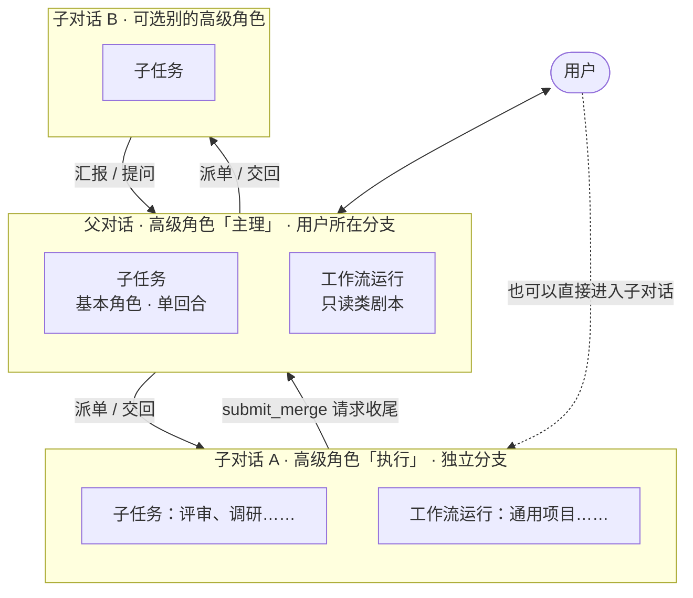
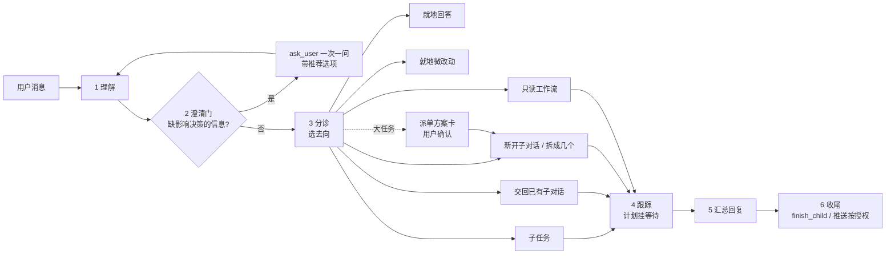

# Design：角色分层与多 Agent 协同调度

> 规划约定：本文里**不加反引号**的路径是实施时才创建的文件（规则检查只校验反引号内的路径必须已存在）；加反引号的是现有文件。
> 现状事实按 2026-10-27 的代码核对。

## 目录

1. 现状与问题
2. 目标 / 非目标
3. 三个正交维度：位置、角色、流程
4. 执行位置：父对话、子对话、子任务、工作流运行
5. 角色模型：基本角色与高级角色
6. 内置角色重组
7. 父对话「主理」的消息处理流水线
8. 协同协议：派单、回报、提问、协调
9. 工作流的位置
10. 场景走查
11. 数据模型与迁移
12. 界面
13. 成本与可观测
14. 风险与对策
15. 分阶段实施
16. 验证方案
17. 待确认的决策
18. 与现有 ADR、教训的关系

---

## 1. 现状与问题

### 1.1 现状事实

| 方面         | 现状                                                                                                                                                                                                          | 出处                                               |
| ------------ | ------------------------------------------------------------------------------------------------------------------------------------------------------------------------------------------------------------- | -------------------------------------------------- |
| 角色和位置   | 顶层项目对话默认「统筹」（`orchestrator`），子对话默认「执行」（`worker`），`spawn_agents` 不点名默认「子任务」（`helper`），AI 分析默认「分析」（`analyzer`）                                                | `shared/builtin/core.ts` 的 `coreUse`              |
| 角色能力开关 | `canDelegate`（能开子对话，只在顶层对话生效）、`canPlan`（能 `start_plan`）、`common`（任何角色都能派它当子任务）、`runIn`（子对话点名时转交父对话）、`includes`（把别的角色的设定**全文拼进来**，最多 3 层） | `shared/schema.ts` 的 `AgentInput`                 |
| 角色组合     | 只有 `includes` 一种：纯提示词拼接，被引入的角色不能「派出去」，也没有「什么时候用它」的说明；内置角色全都 `includes` 了「通用约束」                                                                          | `shared/agent-role.ts` 的 `composeRole`            |
| 统筹的职责   | 「只统筹不动手」：不改、不建、不删文件，改动再小（一行、一个文案）也交给子对话；只收集到模块为止                                                                                                              | `shared/builtin/agents.ts` 的统筹设定              |
| 能力调用     | 文档、评审、测试验收、版本控制各是独立角色；执行角色收尾时依次派「评审」（必须）、「文档」（`runIn: parent`）、「测试验收」（改动大时）、「版本控制」（没有 `submit_merge` 时）                               | 执行角色设定、ADR 0013 / 0019                      |
| 冷启动成本   | 统筹设定原文：「每开一个新子对话都要重新注入角色设定、通用约束、AGENTS.md、项目教训和技能清单，一个只干 30 秒动作的子对话也要二十万 token 起步」                                                              | 统筹设定「派单的粒度」                             |
| 位置的权限   | 由 `Orchestra` 的一组布尔值决定工具暴露：`coordinator`（开子对话）、`helper`（自己是子任务）、`child`、`canSubmit`、`planning`、`plans`、`peers`、`parentOf`、`claims`……                                      | `shared/engine.ts`、`server/orch-mcp.ts`           |
| 子任务       | 单回合、不能再派子任务、不能启动工作流、不能开子对话、不能向用户提问，默认只读；一步最多 12 个（`MAX_HELPERS_PER_STEP`）；失败用 `resume` 在原记录重试                                                        | `helper` 设定、`shared/engine.ts`                  |
| 子对话       | 可以多轮、用户可进入；在独立分支里改、测、评审，`submit_merge` 请父对话 `finish_child` 合回；不能开子对话、不能互相通讯；提问按「提问」开关交给用户或父对话                                                   | ADR 0005 / 0007、`shared/child-ask.ts`             |
| 工作流       | 子对话用 `start_plan` 启动，这一轮结束后同步跑完，结果交回对话；工作流有自己的主 Agent（`mainAgentId`）做节点间调度（`dispatch`）；节点用某个角色                                                             | `shared/engine.ts` 的 `plan`、`shared/dispatch.ts` |

### 1.2 问题

| #   | 问题                                                                                                                                                                                                   | 后果                                                                   |
| --- | ------------------------------------------------------------------------------------------------------------------------------------------------------------------------------------------------------ | ---------------------------------------------------------------------- |
| P1  | **角色绑死在位置上**：顶层=统筹、子对话=执行、子任务=子任务。想要「一个懂 UE 的父对话」「一个只做文档的子对话」只能另建角色，而新角色又拿不到统筹/执行那套调度规则                                     | 角色越建越多、越来越像（agent-catalog 里已经合并过 12 个）             |
| P2  | **能力只能「派」不能「用」**：文档、评审、测试验收、版本控制只能作为子任务派出。补一行模块说明、跑一条快速检查也要冷启动一次                                                                           | token 成本高、等待时间长；统筹设定里不得不写大段「派单粒度」来省钱     |
| P3  | **`includes` 只是全文拼接**：引入越多提示词越长，被引入的角色没有「什么时候用」「怎么用」，也不能选择派出去                                                                                            | 组合能力的唯一手段既贵又不灵活                                         |
| P4  | **父对话不会先想再动**：没有固定的「理解 → 澄清 → 决定去向」流程；提问规则（通用约束）、分派规则（统筹）、拆分确认（`confirm` 参数）散在三处；而且被禁止就地做任何改动                                 | 用户说一句改个文案也要等一个子对话起来；需求不清时直接派出去，返工     |
| P5  | **位置和职责没有一张统一的表**：子任务和子对话怎么选、工作流算执行者还是流程、工作流的主 Agent 和对话的角色是什么关系，都要读代码才知道；`Orchestra` 上十几个布尔值同时受「位置」和「角色开关」影响    | 新功能（如 ADR 0019 的 `runIn`）每次都要在几处补判断；用户无法预期行为 |
| P6  | **能力的「就地 / 派出」偏好写在参数里，各写各的**：执行的 `verify`（自动 / 交给测试验收 / 自己跑）其实就是「测试验收这个能力就地用还是派出」；统筹「文档交给文档角色」也是同一类决定，但没有统一的表达 | 同一类决定每个角色重新发明一遍参数                                     |

---

## 2. 目标 / 非目标

**目标**

1. 用户在父对话里说一句话，父对话能**先分析、不懂就问、再决定**：就地回答 / 就地小改 / 派子任务 / 开或交回子对话 / 走工作流，并且把决定和理由摆在台面上，用户能一键改派。
2. 角色分两层：**基本角色**专注一个能力块；**高级角色**挂载多个基本角色，自己决定每个能力是就地用还是派出去。
3. 位置（父对话、子对话、子任务、工作流运行）的定位、生命周期、上下文、权限写成**一张矩阵**，由面板强制；角色只决定「怎么做」。
4. 能力**按需加载**：高级角色的提示词只带挂载能力的索引，用到时再取全文。
5. 兼容：现有角色、工作流、对话、参数取值不丢；第一阶段上线后行为与现在逐字一致。

**非目标**

- 不允许子对话再开子对话（树最多两层：父对话 → 子对话，子任务挂在任意对话下）。
- 不做子对话之间直接通讯（仍由父对话转达，父对话之间仍用 `message_peer`）。
- 不改合并、评审门禁、交接摘要、测试分档、计划状态机这些已定机制，只重新安放。
- 不改 CLI 接入、模型档位和输出解析。

---

## 3. 三个正交维度：位置、角色、流程

以前的混乱来自把三件事揉在一起。新模型把它们拆开，各管一件：

| 维度                 | 回答的问题                   | 取值                                              | 谁决定                                     | 约束力                      |
| -------------------- | ---------------------------- | ------------------------------------------------- | ------------------------------------------ | --------------------------- |
| **位置**（执行容器） | 在哪里跑、能做什么、跑多久   | 父对话、子对话、子任务、工作流运行                | 面板（按对话层级、是否独立分支、谁派出的） | **硬**：工具暴露 + 调用校验 |
| **角色**             | 谁来做、按什么方法、会哪些事 | 基本角色（单能力）、高级角色（多能力 + 调度策略） | 用户配置；父对话派单时可选                 | 软为主：提示词 + 可派范围   |
| **流程**（工作流）   | 按什么顺序、过哪些门禁       | 内置 / 自定义工作流                               | 对话里的高级角色按情况选，或用户指定       | 由执行引擎保证顺序和门禁    |

再加一个贯穿三者的**执行计划**（`set_plan`）：它不是执行者，是每个对话的进度表，所有等待（子对话、子任务、后台命令、工作流）都挂在计划的步骤上（ADR 0021）。

一句话版：**位置定边界，角色定方法，流程定顺序，计划记进度。**

---

## 4. 执行位置

### 4.1 四种位置



| 位置           | 一句话定位                                | 交付物                       | 生命周期                                | 上下文                                     | 用户能否直接对话 | 用什么角色     |
| -------------- | ----------------------------------------- | ---------------------------- | --------------------------------------- | ------------------------------------------ | ---------------- | -------------- |
| **父对话**     | 用户的入口和总负责人                      | 对用户的答复、整体结果       | 长期，跨很多条用户消息                  | 全局：所有子对话的状态、用户定的规则、历史 | 是（主入口）     | 高级角色       |
| **子对话**     | 一件**交付物**的负责人（功能、Bug、重构） | 合回父对话分支的代码改动     | 多轮；完成 = 合回 + 父对话测试通过      | 自己这件事：派单内容 + 自己查到的          | 是               | 高级角色       |
| **子任务**     | 一次**能力调用**                          | 一段结论 / 文档 / 检查结果   | 单回合，做完即交回；可被发起方 `resume` | 只有派单里写的 + 自己读到的                | 否               | 基本角色       |
| **工作流运行** | 在某个对话里按剧本跑一遍                  | 按流程图产出（节点结果汇总） | 一次运行；结束后结果交回宿主对话        | 每个节点独立，节点间靠交接与共享状态       | 否（经宿主对话） | 节点用基本角色 |

**选子对话还是子任务的判据**（父对话和子对话都用这一条）：

> 交付物是**要合回去的代码改动**，或者需要**多轮、要用户参与、要自己的计划和收尾** → 子对话；
> 交付物是**一段结论、一份文档、一次检查结果**，一个回合能做完、不需要问人 → 子任务。

### 4.2 位置权限矩阵（面板强制）

✓ = 允许；✗ = 面板拒绝；◐ = 有条件（见脚注）。角色的调度策略只能在这张表的 ✓ 范围内**再收紧**，不能放宽。

| 动作                                     | 父对话 | 子对话        | 子任务 | 工作流节点      |
| ---------------------------------------- | ------ | ------------- | ------ | --------------- |
| 回答、读代码、跑只读命令                 | ✓      | ✓             | ✓      | ✓               |
| 向用户提问（`ask_user`）                 | ✓      | ◐¹            | ✗      | ✗（问主 Agent） |
| 改文件                                   | ◐²     | ✓             | ◐³     | ✓               |
| 后台长命令（`run_background`）           | ✓      | ✓             | ✓      | ✓               |
| 派子任务（`spawn_agents`）               | ✓      | ✓             | ✗      | ✓               |
| 开 / 交回子对话                          | ✓      | ✗             | ✗      | ✗               |
| 启动工作流（`start_plan`）               | ◐⁴     | ✓             | ✗      | ✗（不嵌套）     |
| 请求收尾（`submit_merge`）               | ✗      | ✓（独立分支） | ✗      | ✗               |
| 收尾子对话（`finish_child`）、父对话测试 | ✓      | ✗             | ✗      | ✗               |
| 推送 / PR / submit / 合并主干            | ◐⁵     | ✗             | ✗      | ✗               |
| 和其他父对话传话（`message_peer`）       | ✓      | ✗             | ✗      | ✗               |

1. 子对话的提问按「子对话提问路由」走（见 8.3），默认先交父对话。
2. 新增「就地微改动」，必须先过 `begin_inline_edit` 护栏（见 7.5）；否则仍然不改文件。
3. 默认只读；派单里明确要改（例如「文档」子任务）时才写，写的文件记到它的节点上。
4. 只允许不改代码的工作流（代码评审、架构设计、发布范围）；改代码的工作流只能在子对话里跑。
5. 只在用户明确要求时，按「通用约束」的安全边界执行。

这张表对应现在 `Orchestra` 的那组布尔值。实施时把它收成一处：位置算出一组「允许的动作」，再和角色的调度策略取交集，`orchTools` 只按交集出工具（见 11.3）。

### 4.3 和 Claude Code 的对照

用户的参照物是 Claude Code，对齐它的心智模型能少解释很多：

| Claude Code                                      | Agent 面板（新模型）                               |
| ------------------------------------------------ | -------------------------------------------------- |
| 主会话                                           | 父对话（主理）                                     |
| Task 工具派出的 subagent（一次性，结果回主会话） | 子任务                                             |
| 后台 / worktree 隔离的 agent                     | 子对话                                             |
| `.claude/agents/*.md` 的 subagent 定义           | 基本角色                                           |
| Skill（只放描述，用到再读全文）                  | 高级角色挂载能力的「就地」用法（`use_capability`） |
| Plan mode + 提问工具                             | 澄清门 + 派单方案确认                              |
| TodoWrite                                        | 执行计划（`set_plan`）                             |
| 斜杠命令里写好的多步剧本                         | 工作流                                             |

差别在于面板多了一层「子对话」：它能独立分支、多轮、用户可进入，并且有面板强制的收尾（评审门禁、合回、父对话测试）。

---

## 5. 角色模型

### 5.1 两层

| 层           | 是什么                                       | 用在哪                             | 例子                                                  |
| ------------ | -------------------------------------------- | ---------------------------------- | ----------------------------------------------------- |
| **基本角色** | 一个能力块：方法 + 参数 + Skill + 交付标准   | 子任务、工作流节点、被高级角色挂载 | 调研、方案设计、开发、评审、测试验收、文档、版本控制  |
| **高级角色** | 一个「负责人」：定位 + 挂载的能力 + 调度策略 | 父对话、子对话                     | 主理、执行、分析；用户自建的「UE 主程」「文档负责人」 |

规则：

- **对话（父 / 子）只能用高级角色；子任务和工作流节点只能用基本角色。** 用户在对话里选了一个基本角色（例如直接用「每日工作总结」开对话）时，面板把它当成「只挂它自己、就地预加载、不能派出」的隐式高级角色，行为和现在一样。
- **只挂一层**：高级角色只能挂基本角色，不能挂高级角色，基本角色不能再挂别人。避免递归和提示词爆炸；现在 `includes` 最多 3 层的限制随之退场。
- 「通用约束」不再是被引入的角色，而是**基础层**：所有角色、所有位置都有，由面板注入（见 5.5）。

### 5.2 基本角色多出来的字段

基本角色保留现有的 `instructions`、`params`、`skills`、运行配置，新增一组「被使用时的规矩」：

| 字段          | 含义                                                                 | 例子                                       |
| ------------- | -------------------------------------------------------------------- | ------------------------------------------ |
| `when`        | 一句话：什么情况下该用它（进能力索引，模型据此决定调不调）           | 评审：「改完并跑过快速检查、完整测试之前」 |
| `modes`       | 允许的用法：`inline`（就地）、`subtask`（派成子任务）                | 评审只允许 `subtask`                       |
| `independent` | 必须在独立上下文里做（结论要不受执行者思路影响）；为真时不能就地用   | 评审 = 真                                  |
| `readOnly`    | 只读能力：派成子任务时默认不给写权限                                 | 调研 = 真                                  |
| `runIn`       | 现有字段，保留：子对话派它时转交父对话（ADR 0019）                   | 文档 = `parent`                            |
| `brief`       | 派它时交接单要哪些字段（现在只有评审有 `review` 交接单，推广成通用） | 文档：要记什么、依据在哪                   |

### 5.3 高级角色：挂载与调度策略

```ts
// 示意，不是最终代码
interface Mount {
  agentId: string // 挂哪个基本角色
  mode: 'auto' | 'inline' | 'subtask' | 'parent' // 怎么用；不能超出基本角色的 modes
  preload?: boolean // 就地用时是否把全文直接放进提示词（常用能力，免得每次取）
  params?: ParamValues // 挂载时给这个能力定的参数取值
  rule?: string // auto 时补一句「什么时候就地、什么时候派出」，进能力索引
}

interface DispatchPolicy {
  inlineEdit: 'off' | 'tiny' // 就地微改动（只对父对话有意义）
  subtask: boolean // 能派子任务
  child: boolean // 能开 / 交回子对话（只对父对话有意义）
  workflow: boolean // 能启动工作流
  clarify: 'auto' | 'always' | 'never' // 澄清门的力度（见 7.3）
  confirm: 'never' | 'large' | 'always' // 派单方案要不要先给用户确认（替代统筹的 confirm 参数）
}
```

**四种用法**：

| `mode`    | 执行方式                                                                                        | 适合                                               |
| --------- | ----------------------------------------------------------------------------------------------- | -------------------------------------------------- |
| `inline`  | 在当前对话里做：用 `use_capability` 取能力全文（或 `preload` 直接在提示词里），按它的方法自己做 | 量小、要用当前上下文的：快速检查、提交、补一段文档 |
| `subtask` | `spawn_agents` 派给这个基本角色                                                                 | 要独立视角（评审）、量大、可并行、只读调研         |
| `parent`  | 在子对话里点名时转交父对话创建子任务（现有 `runIn: parent` 的语义，挂载级可以覆盖）             | 不阻塞主线、不依赖子对话本地 diff 的长活           |
| `auto`    | 由高级角色按 `rule` 和下面的通用判据自己选；能力索引里写清两种用法的分界                        | 大多数能力                                         |

`auto` 的通用判据（写进基础层，所有高级角色共用）：

1. 能力 `independent` → 一律派出。
2. 要用到当前对话里大量已读内容、派出去要把这些重新交代一遍 → 就地。
3. 预计读写超过一个模块、或预计要几分钟以上、或能和别的事并行 → 派出。
4. 拿不准 → 就地先做第一步，发现量大再派（派单里写清已做到哪）。

**能派谁**：挂载里允许 `subtask` 的基本角色 + `common: true` 的通用角色（兼容现有语义）+ 兜底的「通用子任务」。没挂、也不是通用的基本角色，`spawn_agents` 点名时面板拒绝并列出能派的。

### 5.4 参数优先级

从高到低：对话或节点上这次选的值 → 项目里的 `Project.agentParams` → **挂载上的 `params`** → 基本角色自己的默认值。
同名参数仍然可以「一个开关管一串」：高级角色的参数和挂载能力同名时，高级角色的取值往下传（现在 `composeRole` 对 `includes` 就是这么做的），挂载上显式写的优先。

### 5.5 提示词怎么拼（高级角色）

按顺序，越往上越稳定（利于 CLI 的提示词缓存）：

1. **基础层**：通用约束（语言、编码、提问、命令执行、等待上限、安全边界），加上 5.3 的 `auto` 判据。
2. **位置层**：面板按位置生成——你是父对话 / 子对话 / 子任务，能做什么不能做什么、怎么交回、计划规则、后台命令、独立分支、测试范围（现在 `shared/engine.ts` 里的 `buildPart`、`planPart`、`backgroundPart`、`verifyPart` 等就是这一层，原样保留）。
3. **角色层**：高级角色自己的设定（定位、决策规则、汇报方式），套上参数。
4. **能力索引**：每个挂载一行——`名字 · 什么时候用 · 用法（就地：先调 use_capability；派出：spawn_agents agent=名字；转交：自动）· 关键约束一句话`。
5. **预加载的能力全文**：`preload: true` 的挂载直接放全文（例如执行角色的「开发」），标题写「## 能力：开发（已加载）」。
6. **本次参数、Skill 清单**（现有）。

和现在的对比：执行角色今天把评审、文档、测试验收、版本控制的用法全写在自己的设定里（几千字），统筹也写了一大段「文档交给文档、验证交给测试验收」。新模型里这些话分别回到各基本角色的 `when` / `instructions`，高级角色只留一行索引，用到再取。

### 5.6 `use_capability`：就地加载能力

新的面板工具，高级角色就地用某个挂载能力前调用：

- 入参：`name`（能力名）、可选 `params`（这次的取值，覆盖挂载值）。
- 返回：这个基本角色按参数渲染后的 `instructions` 和 Skill 清单；对话里画一行「加载能力 · 评审规则」。
- 同一会话里重复调用同一能力、参数也没变：返回一句「已加载，见上文」，不重复占上下文；换了新会话（交接摘要续接、上下文压缩）面板清空已加载记录。
- `independent` 或 `modes` 不含 `inline` 的能力：拒绝并说明「这个能力只能派出：spawn_agents agent=…」。

---

## 6. 内置角色重组

### 6.1 映射

key 全部保留（参数取值、工作流引用、`agent-aliases` 都按 key 走，不动最省事）。

| key                               | 现名     | 新层               | 新名（建议） | 说明                                                                              |
| --------------------------------- | -------- | ------------------ | ------------ | --------------------------------------------------------------------------------- |
| `rules`                           | 通用约束 | 基础层（不是角色） | 通用约束     | 由面板对所有角色注入；数据保留，旧的 `includes` 引用读出来跳过，不重复拼          |
| `orchestrator`                    | 统筹     | 高级               | **主理**     | 父对话默认。从「只统筹不动手」改为「先分析、再决定、能就地做微小的事」，见第 7 节 |
| `worker`                          | 执行     | 高级               | 执行         | 子对话默认                                                                        |
| `analyzer`                        | 分析     | 高级               | 分析         | AI 分析对话默认；挂「调研」就地预加载，不能派子对话                               |
| `helper`                          | 子任务   | 基本（隐藏）       | 通用子任务   | `spawn_agents` 不点名时的兜底；仍不在角色列表里展示                               |
| `explorer`                        | 调研     | 基本               | 调研         | `modes: inline, subtask`；`readOnly`                                              |
| `analyst`                         | 方案设计 | 基本               | 方案设计     | `modes: inline, subtask`；`scale=architectural` 时建议派出                        |
| `developer`                       | 开发     | 基本               | 开发         | `modes: inline, subtask`                                                          |
| `reviewer`                        | 评审     | 基本               | 评审         | `modes: subtask`、`independent`；门禁不变（ADR 0009 / 0010 / 0013 / 0022）        |
| `tester`                          | 测试验收 | 基本               | 测试验收     | `modes: inline, subtask`                                                          |
| `docsync`                         | 文档     | 基本               | 文档         | `modes: inline, subtask`；`runIn: parent` 保留                                    |
| `vcs`                             | 版本控制 | 基本               | 版本控制     | `modes: inline, subtask`                                                          |
| `deps` `spec` `blender` `worklog` | —        | 基本               | 不变         | `worklog`、`blender` 常被直接拿来开对话，走 5.1 的「隐式高级角色」                |

必备角色（`CORE_AGENTS`）集合不变，仍由面板维护定义（ADR 0015）；新增的挂载和调度策略也属于「定义」，每次启动按内置同步，用户能改的仍是参数取值、运行配置，以及**挂载上的参数取值和 `mode`**（`mode` 不能超出基本角色允许的范围）。

### 6.2 内置高级角色的挂载

**主理（父对话）**

| 挂载     | mode      | preload | 规则                                                                                   |
| -------- | --------- | ------- | -------------------------------------------------------------------------------------- |
| 调研     | `auto`    | 否      | 读几个文件、对照模块文档就能答的就地；跨模块、多方向对比、要查外部资料的派出（可并行） |
| 方案设计 | `auto`    | 否      | 澄清和分诊时就地用它的「识别现场、定口径」；`scale=architectural` 派出                 |
| 评审     | `subtask` | —       | `target=方案或结论`：大方案派单前、子对话结论有疑点时让它独立复核                      |
| 文档     | `auto`    | 否      | 一两处已知内容的小改（例如勾 backlog、补一行索引）随就地微改动做；其余派出             |
| 测试验收 | `subtask` | —       | 合并后的父对话测试由面板自动跑（ADR 0018 / 0020），这里只用于用户点名的整体回归        |
| 版本控制 | `inline`  | 否      | 只在用户要求推送、PR、合并主干时就地用；就地微改动后的本地提交也走它                   |

调度策略：`inlineEdit: tiny`、`subtask: true`、`child: true`、`workflow: true`（仅只读类）、`clarify: auto`、`confirm: large`。
保留现有参数：`vcs`、`split`、`report`；`confirm` 参数迁到调度策略。

**执行（子对话）**

| 挂载     | mode      | preload | 规则                                                                                    |
| -------- | --------- | ------- | --------------------------------------------------------------------------------------- |
| 开发     | `inline`  | 是      | 主能力，全文常驻（含「按模块逐层定位」）                                                |
| 调研     | `auto`    | 否      | 本模块内就地；要看影响面、跨模块调用方时派出                                            |
| 方案设计 | `inline`  | 否      | 涉及口径、数据模型、跨模块契约时先就地定口径（执行设定里现有的第 1 步）                 |
| 测试验收 | `auto`    | 否      | 快速检查就地；完整测试、端到端按测试范围交给父对话或派出（取代 `verify` 参数，见 11.4） |
| 评审     | `subtask` | —       | 收尾门禁要求的独立评审，规则不变                                                        |
| 文档     | `parent`  | —       | 转交父对话（ADR 0019 现状）                                                             |
| 版本控制 | `inline`  | 否      | 有 `submit_merge` 时就是它；没有时就地按版本控制能力做本地提交 / pending 分桶，或派出   |

调度策略：`subtask: true`、`child: false`（位置也不允许）、`workflow: true`、`clarify: auto`。保留参数 `vcs`、`mode`、`batch`。

**分析（AI 分析对话）**：挂「调研」`inline + preload`；调度策略全关（不能派、不能开、不能起工作流），与现状一致。

### 6.3 用户自建高级角色的例子

- **UE 主程**：挂调研（`stack=ue`、`auto`）、开发（`inline + preload`）、测试验收（`auto`）、评审（`subtask`）。拿来当子对话的角色，父对话派 UE 相关任务时点名它。
- **文档负责人**：挂文档（`inline + preload`）、调研（`auto`）、评审（`subtask`，`target=方案或结论`）。开一个子对话专门整理一整块文档，不用每份文档派一次子任务。
- **只读顾问**（父对话的另一种默认）：挂调研、方案设计、评审，`inlineEdit: off`、`child: false`：只出方案、不派活。

---

## 7. 父对话「主理」的消息处理流水线

### 7.1 总览



每一步都在主理自己的一轮里完成，不额外起 CLI；只有派出去的事才冷启动。

### 7.2 第 1 步：理解

- 一句话复述用户要什么（这句会出现在分诊卡上，用户一眼能看出理解对不对）。
- 对照现有子对话的标题、状态和最近结果，判断关联强度：明确相关、可能相关、无关。后续消息每条都重新判断，不默认交给上一个。
- 只收集到**模块**为止：涉及哪个模块、入口文件或目录、相关文档（模块地图、模块 README、AGENTS.md）。不找到具体哪一行——这条现有规则保留，理由也不变：父对话挖得越深，子对话越容易被它的猜测带偏。

### 7.3 第 2 步：澄清门

**问不问**，按下面的顺序判断，命中一条就问：

| 情况                                           | 例子                                     |
| ---------------------------------------------- | ---------------------------------------- |
| 有两种以上合理理解，而且会做出**不同的交付物** | 「导出图片」是导出整张画布还是选中的节点 |
| 大任务缺**验收标准**，做完也没法判断算不算好   | 「优化一下性能」没说哪个页面、什么指标   |
| 要做**不可逆或对外**的事                       | 删数据、推送、发布、改别人的分支         |
| 是**偏好**，查代码查不出来                     | 两种界面方案选哪个                       |

**不问的**：能查到的事实自己查（通用约束已有）；有合理默认值的小选择直接选，写进分诊卡的「假设」里，用户不同意可以改派。

**怎么问**：沿用通用约束的提问规则——用 `ask_user`，推荐项放第一个并标「（推荐）」，每题 2–4 个选项、每个一句话说后果；每轮优先只问一个影响决策的问题，几个互不依赖的问题最多一起问三个。用户回答后回到第 1 步。

`clarify` 策略：`auto` 按上表；`always` 大任务一律先问一轮需求（适合需求常常说不清的团队）；`never` 一律按假设走、只在不可逆操作前问。

### 7.4 第 3 步：分诊决策表

从上往下，命中即停：

| #   | 情况                                                                       | 去向                                                    |
| --- | -------------------------------------------------------------------------- | ------------------------------------------------------- |
| 1   | 和某个子对话明确相关：追加要求、返工、验收没过、测试挂了、它提的问题的答案 | **交回原子对话**（`send_to_conversation`）              |
| 2   | 问答、讨论、解释、查一个事实，读几个文件就能答                             | **就地回答**                                            |
| 3   | 满足就地微改动护栏（7.5）的改动                                            | **就地微改动**                                          |
| 4   | 只读：跨模块调研、几个方向对比、核实一个结论、写一份调研报告               | **子任务**（调研 / 方案设计 / 评审-结论），能并行就并行 |
| 5   | 只写文档、不改代码                                                         | **子任务**（文档），多份文档一次派完                    |
| 6   | 要改代码的交付：功能、Bug、重构、迁移                                      | **新开子对话**（可选角色，默认执行）                    |
| 7   | 一条消息里几件互不相关的交付，文件范围不重叠                               | **拆成几个子对话并行**（`split` 参数）                  |
| 8   | 几件事文件范围重叠                                                         | 合成一个子对话，或排先后（后一个在前一个合回后再派）    |
| 9   | 只读的固定剧本：代码评审、架构设计、发布范围                               | **就地跑工作流**（`start_plan`）                        |
| 10  | 推送、PR、合并主干、发布                                                   | **就地用版本控制能力**，按授权规则                      |

叠加两条：

- `confirm: large` 时，跨模块、改公共接口、预计很久、要拆三个以上子对话的，先出**派单方案卡**（几个子对话、各自范围和角色、先后顺序、预计成本档）给用户确认，确认后再派。
- 派单粒度规则保留（同类小动作攒成一次派单、纯执行动作写 `tier: low`、同一个子对话能接着用就接着用、一棵代码树只做一次整体验收），但从统筹设定里搬到基础层的「派单」一节，子对话派子任务时也适用。

### 7.5 就地微改动与护栏

这是本设计唯一放宽父对话权限的地方，必须有硬护栏。它解决「改个文案也要等一个子对话」，**不**用来让父对话自己查问题、试着修。

**进入条件**（主理自己判断，面板校验能校验的）：

| 条件                                                     | 谁校验 |
| -------------------------------------------------------- | ------ |
| 改什么、改成什么，用户已经说清或一眼可知，**不需要排查** | 主理   |
| 最多 2 个文件、合计改动不超过 20 行（阈值可在设置里调）  | 面板   |
| 不动公共接口、数据格式、schema、CLI 定义、执行流程       | 主理   |
| 要改的文件没有被运行中的子对话认领或改动                 | 面板   |
| 当前没有子对话正在合回这个分支                           | 面板   |
| 项目的快速检查能在一分钟内跑完                           | 主理   |

**流程**：

1. 调 `begin_inline_edit`，写 `files` 和 `reason`。面板检查上表中它负责的几条，通过后：认领这些文件、暂停这个父对话的合回队列（`finish_child` 排队等它）。
2. 改文件（同一个提交里该带的也带上，例如本项目的文案要连英文翻译一起改）。
3. 按项目测试步骤跑标「快速」的检查。
4. 用版本控制能力做本地提交（按 `vcs` 参数；P4 按 pending 分桶）。
5. 调 `end_inline_edit`（或这一轮结束时面板自动收）：面板核对实际改动——超出文件数或行数阈值、碰了没声明的文件，就在对话里写一条醒目的「就地改动越界」提示，并给「转成子对话评审」按钮；然后释放认领、恢复合回队列。

**不做的**：就地微改动不派评审（体量上不值得），但越界时一定建议评审；不在独立分支外开 worktree；不跑完整测试。

`inlineEdit: off` 时完全回到现在的行为（父对话不改文件）。

### 7.6 分诊卡（让决定看得见、改得了）

每次分诊落成一张卡，画在用户消息下方：

```
分诊 · 新开子对话「工作流导出 PNG」（执行）
理解：给流程图画布加导出 PNG，导出整张画布
假设：只导出可见区域以外的节点也包含在内（你没说，按完整画布）
理由：要改 web/src/components/flow 下的导出和工具栏，属于代码交付
                                           [改为就地] [改为子任务] [撤回]
```

- 不新增「先报分诊」的工具调用：主理在调用 `create_conversation`、`send_to_conversation`、`spawn_agents`、`start_plan`、`begin_inline_edit`、`ask_user` 时带一个 `route` 参数（`understanding`、`reason`、`assumptions`），面板据此生成卡片；就地回答不出卡。
- 用户点「改为 X」：面板在父对话里发一条「用户改派为 X」的消息（带原消息引用），主理下一轮照做；已经派出的会先停掉（子对话停止、子任务终止）。改派记进 13 节的指标。
- 同一条用户消息分到几处时，一张卡列几行。

### 7.7 第 4–6 步：跟踪、汇总、收尾

- **跟踪**：所有派出都带 `step` 挂到计划上（ADR 0021 现状），主理这一轮说完就结束，等结果推回来，不轮询。
- **汇总**：`report: 精简` 时只写结论和要用户处理的事；一批子对话陆续完成时，等同一批的都回来再合成一条（最长等到下一条用户消息或 10 分钟，先回来的先在计划里打勾）。
- **收尾**：子对话 `submit_merge` 后主理 `finish_child`（ADR 0005），父对话测试由面板自动跑（ADR 0018 / 0020）；推送等对外动作只在用户要求时做。

---

## 8. 协同协议

### 8.1 派单：统一的任务单

现在只有评审有结构化交接单（`spawn_agents` 的 `review`，ADR 0013），开子对话的 `message` 是自由文本。新模型把它推广成一份通用任务单，开子对话和派子任务都用：

| 字段          | 必填       | 写什么                                                         |
| ------------- | ---------- | -------------------------------------------------------------- |
| `goal`        | 是         | 用户原话 + 要达成什么                                          |
| `acceptance`  | 子对话必填 | 验收标准：做到什么算完                                         |
| `scope`       | 子对话必填 | 涉及的模块、目录、文件（替代现在的 `files`）；也写**不许碰**的 |
| `context`     | 否         | 已知事实：现象、复现步骤、报错原文、相关文档路径               |
| `excluded`    | 否         | 已经排除的方向和依据                                           |
| `assumptions` | 否         | 分诊时做的假设（和分诊卡一致）                                 |

面板把任务单渲染成第一条消息（「交代任务」，ADR 0008），缺必填字段直接拒绝并说缺什么。基本角色的 `brief` 字段（5.2）可以要求额外字段（评审的 `changes`、`checks`、`focus` 照旧）。

`create_conversation` 新增可选的 `role`：用哪个高级角色开这个子对话，默认「执行」；只能选本机启用的高级角色。

### 8.2 回报

不变：子对话状态上报只走 `reportChild`（ADR 0005）；完成时写交接摘要（ADR 0007）；子任务结果自动交回发起方。新增一条：子对话上报的结论里要能对上任务单的 `acceptance`，逐条写「达成 / 未达成 / 改了口径」。

### 8.3 提问路由

子对话遇到要人决定的事，三档（替代现在的「子对话也提问」开关，旧值迁移：开 → 用户直答，关 → 主理全权）：

| 档位                 | 行为                                                                                                                                                   |
| -------------------- | ------------------------------------------------------------------------------------------------------------------------------------------------------ |
| **主理先接**（推荐） | 问题先到父对话。主理能从已有信息（用户定过的规则、别的子对话的结论、分诊时的假设）答的就答；答不了的带上子对话的背景转问用户，用户的回答直接回到子对话 |
| 用户直答             | 问题直接给用户（现在开关打开时的行为）                                                                                                                 |
| 主理全权             | 主理按已有信息替用户选，写清「替你决定了什么、依据、不对怎么改」（现在开关关着时的行为）                                                               |

「主理先接」是 Claude Code 主会话处理 subagent 疑问的方式：大部分问题主会话自己就能答，真正要用户拍板的才打扰用户。

### 8.4 跨子对话协调

- 子对话之间不通讯，由主理转达（现状）。
- 主理派单时保证 `scope` 不重叠（7.4 第 7、8 条）；共享目录模式下仍靠文件认领（`claim_files`）。
- 合回冲突退回子对话自己解决（现状）。
- 一个子对话的结论影响另一个时：主理用 `send_to_conversation` 交过去，写清来源；不让两个子对话同时改同一个口径。

### 8.5 失败与重试

不变（`docs/lessons/retry.md`）：子对话失败交回原子对话重试，子任务失败用 `resume` 在原记录重试；错误一律显示给用户，不悄悄重试。

---

## 9. 工作流的位置

**工作流是剧本，不是执行者。** 它规定顺序和门禁，在某个对话里运行一次；节点是一次基本角色的调用。

| 问题                 | 结论                                                                                                                                                                                                                                        |
| -------------------- | ------------------------------------------------------------------------------------------------------------------------------------------------------------------------------------------------------------------------------------------- |
| 谁启动               | 对话里的高级角色按情况选（`start_plan`），或用户在对话里点名                                                                                                                                                                                |
| 在哪跑               | 改代码的工作流只在子对话里跑（它有独立分支和收尾）；只读的（代码评审、架构设计、发布范围）可以在父对话里跑                                                                                                                                  |
| 节点用什么角色       | 只能是基本角色；现有工作流里引用高级角色的节点照常能跑，编辑时提示「节点建议用基本角色」                                                                                                                                                    |
| 工作流的「主 Agent」 | 现在每个工作流有自己的主 Agent 做节点间调度（`dispatch`）。新模型建议：在对话里启动的运行，**默认由宿主对话的高级角色当主 Agent**——它本来就知道这件事的来龙去脉，不用再冷启动一个调度者；工作流上写了主 Agent 的照旧用它（见 17 节决策 D4） |
| 什么时候用工作流     | 需要**固定顺序和门禁**的多阶段事务（规范开发、迁移、依赖升级、发布）；日常改动和 Bug 不必走工作流（现有 `worker.mode=自动` 的判断不变）                                                                                                     |
| 和挂载能力的关系     | 挂载能力是「随手用」，工作流是「按剧本用」；同一个能力两种都能用，参数取值规则一致（5.4）                                                                                                                                                   |

内置工作流里的节点角色已经都是基本角色（analyst、developer、docsync、explorer、reviewer、tester、vcs、deps、spec、blender），主 Agent 用到了 `orchestrator` 和几个基本角色；工作流定义本身不用改。

---

## 10. 场景走查

**A. 「设置页那个『保存』按钮改成『保存设置』」**

1. 理解：改一个按钮文案。无歧义，不问。
2. 分诊：第 3 条，就地微改动。卡片：「就地微改动 · 改设置页保存按钮文案」。
3. `begin_inline_edit`（组件文件 + `shared/locales/en/` 下对应文件），改中文原文和英文翻译。
4. 跑快速检查（类型检查与漏翻、代码检查与格式），本地提交。
5. 回复：改了哪两处、检查结果、提交号。全程没有冷启动。

**B. 「流程图加个导出 PNG，顺便把各个页面的导出按钮图标统一一下」**

1. 理解：两件事。导出 PNG 有歧义（整张画布还是选中节点）→ 澄清门命中第 1 条，`ask_user` 一题：「整张画布（推荐）/ 只导出选中的节点」。
2. 用户选整张画布。分诊：两件都是代码交付；导出功能落在流程图组件，图标统一散在多个页面，可能都碰工具栏文件 → 第 8 条，范围有重叠。主理选择：先开「导出 PNG」子对话，图标统一排在它合回之后再派（卡片上写明理由，用户可以改成合并成一个）。
3. 子对话（执行）：判断是正式功能 → `start_plan` 按「通用项目」工作流；完成后派评审子任务、处置意见、`submit_merge`；文档转交父对话。
4. 父对话收到收尾请求 → `finish_child`，面板跑父对话测试 → 通过 → 主理派第二个子对话，汇总回复。

**C. 「子对话合并之后，父对话计划里那一步一直显示等待中」（Bug）**

1. 理解：计划状态没收口。对照模块地图定位到计划模块（`shared/plan.ts`）和任务收尾（`server/tasks.ts`）。现象清楚，不问。
2. 分诊：第 6 条，新开子对话，任务单写现象、复现、模块入口、相关 ADR 0021。
3. 子对话按「按模块逐层定位」找到并修，补用例；评审子任务；文档 `parent` → 父对话那边派文档子任务写 Bug 记录（用户报的 Bug）。
4. 父对话合回、测试、汇总。

**D. 「对比一下 Codex 和 Pi 的 RPC 会话实现，看哪个更稳」**

1. 理解：只读对比。不问。
2. 分诊：第 4 条，两个调研子任务并行（各看一个 CLI 的实现），`tier` 用默认档。
3. 两份结果回来，主理就地用方案设计能力写对比结论；需要长期保留时再派文档子任务。

**E. 子对话问：「`lastInputAt` 要不要把父对话转达也算进去？」**

- 「主理先接」：主理查到 ADR 0021 已经定了「父对话转达算新输入」→ 直接答，附出处，不打扰用户。

---

## 11. 数据模型与迁移

### 11.1 `AgentInput` 新增字段

```ts
// 示意
kind: z.enum(['basic', 'advanced']).catch('basic') // 读旧数据时按 11.2 推导
// 基本角色
when: z.string().max(200).default('')
modes: z.array(z.enum(['inline', 'subtask'])).default(['inline', 'subtask'])
independent: z.boolean().default(false)
readOnly: z.boolean().default(false)
brief: z.array(BriefField).default([])
// 高级角色
mounts: z.array(Mount).max(16).default([])
policy: DispatchPolicy.optional()
```

保留：`includes`（只对基本角色，作为「文本引入」继续生效；高级角色的 `includes` 迁成挂载）、`canDelegate`、`canPlan`（读时映射到 `policy`，写时不再写；两个版本后删）、`common`、`runIn`。

### 11.2 迁移（启动时一次，幂等）

| 旧数据                                                        | 迁成                                                                                                                         |
| ------------------------------------------------------------- | ---------------------------------------------------------------------------------------------------------------------------- |
| 内置角色                                                      | 按内置定义同步（ADR 0015 现状），定义里带上 `kind`、`mounts`、`policy`                                                       |
| 用户角色，`canDelegate` 或 `canPlan` 为真，或被对话直接使用过 | `kind: advanced`；`includes` 里除「通用约束」外的每一项 → `mount { mode: 'inline', preload: true }`，`policy` 由两个开关映射 |
| 其余用户角色                                                  | `kind: basic`，字段原样                                                                                                      |
| 子对话「提问」开关 `childAskUser`                             | 开 → 用户直答；关 → 主理全权（保持现状行为）。新建的父对话默认「主理先接」                                                   |
| 执行角色的 `verify` 参数                                      | 自动 → 测试验收挂载 `auto`；交给测试验收 → `subtask`；自己跑 → `inline`。参数 key 留一个版本只读，之后删                     |
| 统筹的 `confirm` 参数                                         | 开 → `policy.confirm: large`；关 → `never`                                                                                   |

**第一阶段的硬要求**：`preload: true` 的挂载渲染出的提示词，和原来 `includes` 拼出来的**逐字一致**（单测对所有内置角色和几份用户角色样本做快照比对），这样数据模型可以先上线而行为不变。

### 11.3 位置权限收成一处

新增 shared/dispatch-scope.ts（名字待定）：

- `scopeOf(task, self)` → 这个调用者所在的位置（父对话 / 子对话 / 子任务 / 工作流节点）和它允许的动作集合（4.2 的表）。
- `allowedActions(scope, policy, mounts)` → 位置 ∩ 调度策略 ∩ 挂载，得到最终动作集合。
- `shared/engine.ts` 构造 `Orchestra` 时只从这里取布尔值；`server/orch-mcp.ts` 的 `orchTools` 只按它出工具。调用时再校验一次（工具可能被模型凭记忆调用）。

### 11.4 任务上的新字段

- `Task.routes`：每条分诊记录 `{ messageId, target: 'answer' | 'inline-edit' | 'subtask' | 'child' | 'resend' | 'workflow' | 'vcs', ids, understanding, reason, assumptions, at, overriddenAt? }`。
- `Task.inlineEdit`：进行中的就地微改动 `{ files, reason, startedAt }`，结束时清掉（清字段写 `undefined` 的约定见 `docs/lessons/data.md`）。
- 子对话的提问路由档位 `childAskRoute`（替代 `childAskUser`，读旧值按 11.2 映射）。

### 11.5 新工具

| 工具                                        | 位置           | 作用                                  |
| ------------------------------------------- | -------------- | ------------------------------------- |
| `use_capability`                            | 父对话、子对话 | 就地加载挂载能力的全文（5.6）         |
| `begin_inline_edit` / `end_inline_edit`     | 父对话         | 就地微改动的护栏（7.5）               |
| 现有派单工具加 `route` 参数                 | 父对话、子对话 | 生成分诊卡（7.6）                     |
| `create_conversation` 加 `role`、任务单字段 | 父对话         | 选子对话的高级角色、结构化派单（8.1） |

工具名都要登记进 `shared/panel-tools.ts` 的 `PANEL_TOOL_NAMES`（不登记会显示成原始工具名）。

---

## 12. 界面

- **角色页**：分「高级角色」「基本角色」两组；高级角色卡片上列出挂载的能力图标。必备、内置、自建的分组和计数规则不变（`listableAgents` 仍去掉通用子任务）。
- **高级角色编辑**：新增「能力」区——从基本角色里选挂载，每行一个：能力名、用法下拉（自动 / 就地 / 派出 / 转交父对话，超出能力允许范围的置灰并说明）、「常驻加载」开关、参数取值（复用现有参数表单）、一句规则。下面是「调度」区：就地微改动、能派子任务、能开子对话、能启动工作流、澄清力度、派单前确认。
- **基本角色编辑**：新增「被使用时」区：什么时候用、允许就地 / 派出、必须独立、只读、交接单字段。
- **对话**：分诊卡（7.6）；「加载能力」「就地改动」用和现有工具行一样的样式；越界提示用警告色。
- **父对话设置**：「子对话提问」改成三档单选。
- 所有新文案用 `t('中文原文')`，英文同一提交写进 `shared/locales/en/`；风格按 `docs/lessons/ui.md`。

---

## 13. 成本与可观测

**预期的成本变化**（实施后实测，写进 ADR）：

| 场景                     | 现在                                      | 新模型                                       |
| ------------------------ | ----------------------------------------- | -------------------------------------------- |
| 改一个文案               | 开一个子对话（冷启动一次）+ 合回          | 父对话就地改，零冷启动                       |
| 子对话收尾补一段模块说明 | 转交父对话派文档子任务（冷启动一次）      | 不变（`parent`）；但父对话可以攒到一批一起派 |
| 子对话跑快速检查         | 就地（已是）                              | 就地                                         |
| 执行角色的提示词         | 评审 / 文档 / 测试 / 版本控制用法全文常驻 | 只留索引行，用到再加载                       |

**指标**（记在 `Task.routes` 上，工作总结和分析页可用）：

- 每种去向的次数、平均 token、平均耗时；
- 改派率（用户点了「改为 X」的比例）——高说明分诊规则或阈值要调；
- 澄清次数和澄清后改派率——澄清过多说明 `clarify` 太紧，澄清后仍改派说明问得不对；
- 就地微改动越界次数；
- 能力加载次数（哪些能力常被就地用，考虑改成 `preload`）。

---

## 14. 风险与对策

| 风险                                                                                            | 对策                                                                                                                        |
| ----------------------------------------------------------------------------------------------- | --------------------------------------------------------------------------------------------------------------------------- |
| 就地微改动重演「父对话先把问题查到底、自己动手改」（`docs/lessons/builtin.md` 记过的用户纠正）  | 进入条件要求「不需要排查」；面板硬校验文件数、行数、认领、合回队列；越界醒目提示；`inlineEdit: off` 一键回到现状；见决策 D1 |
| 父对话就地改时子对话正在合回，工作区冲突                                                        | `begin_inline_edit` 暂停这个父对话的合回队列，结束才恢复；有合回进行中时拒绝进入                                            |
| 模型不调 `use_capability` 就凭印象做                                                            | 主能力 `preload`；索引行写关键约束；有门禁的能力（评审、收尾）门禁在面板，不靠模型记得                                      |
| 主理就地做的事多了，父对话上下文膨胀                                                            | 就地调研有上限（读超过一个模块就派出）；父对话照常用交接摘要和上下文压缩；大块只读工作派子任务                              |
| 提示词结构变化，e2e 和单测断言原句失败（`docs/lessons/builtin.md`「改提示词或文案前先搜断言」） | 每阶段先 grep 断言再改；第一阶段要求逐字一致                                                                                |
| 用户自建角色迁移后行为变化                                                                      | 推导规则保守（有 `includes` 的全部 `preload`，等价于全文拼接）；迁移前备份到 `config/backup/`（和合并角色同一套）           |
| 分诊卡的「改派」打断已经在跑的子对话，丢进度                                                    | 改派前确认（「子对话已执行 3 分钟，确定停止并改为就地？」）；停止走现有的用户停止路径，不删分支                             |
| 位置权限收拢时漏掉某个现有判断（`Orchestra` 有十几个开关）                                      | 先写矩阵单测，用现有 `server/orch-mcp.test.ts` 的场景做对照，保证每种位置的工具清单前后一致，再接新能力                     |

---

## 15. 分阶段实施

每个阶段单独可上线、可回退；前一阶段验证通过再开下一阶段。

| 阶段 | 内容                                                                                                           | 行为变化                   | 验收                                                                                     |
| ---- | -------------------------------------------------------------------------------------------------------------- | -------------------------- | ---------------------------------------------------------------------------------------- |
| 1    | 数据模型（`kind`、`mounts`、`policy`、基本角色字段）+ 迁移 + 位置权限收拢 + 角色页两组展示和挂载编辑           | 无（提示词逐字一致）       | 迁移单测、提示词快照一致、工具清单矩阵单测、界面检查                                     |
| 2    | 能力索引 + `use_capability` + 按挂载决定能派谁；执行角色改成「开发预加载 + 其余索引」，`verify` 迁成挂载       | 子对话提示词变短，行为等价 | 单测；e2e 跑通子对话全流程（评审门禁、文档转交、合回）；对比改造前后子对话的提示词 token |
| 3    | 主理流水线：理解 / 澄清门 / 分诊表进角色设定；派单工具加 `route`；分诊卡；任务单；子对话提问三档               | 父对话会先问、出分诊卡     | e2e：场景 B（澄清后派单）、C（Bug 派单）、D（并行子任务）、E（主理先接）；界面检查分诊卡 |
| 4    | 就地微改动：`begin_inline_edit` / `end_inline_edit`、护栏、合回队列暂停、越界检测                              | 父对话可以就地改小东西     | e2e：场景 A；越界、认领冲突、合回进行中三种拒绝路径                                      |
| 5    | 工作流归位：节点基本角色提示、对话里启动的运行默认由宿主角色调度（按决策 D4）；`create_conversation` 的 `role` | 工作流少一次调度者冷启动   | 内置工作流全部 e2e；自定义工作流兼容                                                     |
| 6    | 指标入库与展示；更新 `docs/agent-catalog.md`、模块文档；写 ADR；教训                                           | —                          | 文档检查、ADR 索引                                                                       |

---

## 16. 验证方案

- **单测**：迁移（每条 11.2 规则）、提示词拼装（逐字一致、索引行、预加载）、`use_capability`（拒绝 `independent`、重复加载）、位置 × 策略 × 挂载的工具矩阵、任务单校验、就地微改动护栏（文件数、行数、认领、合回中）、提问三档路由。
- **端到端**（`scripts/fake-cli` 模拟 CLI）：第 10 节五个场景各一条；改派（就地 ↔ 子对话）；旧数据目录启动后行为不变。
- **界面检查**：角色页两组、挂载编辑、分诊卡、越界提示，明暗主题、中英文。
- **实测**：阶段 2、3、4 各在本仓库跑一周真实任务，记 13 节的指标，和改造前同类任务对比 token 与耗时，结论写进 ADR。

---

## 17. 待确认的决策

| #   | 决策                       | 建议（推荐）                                                | 备选                                               |
| --- | -------------------------- | ----------------------------------------------------------- | -------------------------------------------------- |
| D1  | 父对话能不能就地改文件     | **能，限微改动 + 面板护栏，默认开**；不需要的项目关掉       | 不能（维持「只统筹不动手」，只做分诊和澄清）       |
| D2  | 「统筹」改名               | **改为「主理」**，key 不变                                  | 保留「统筹」                                       |
| D3  | 子对话提问的默认档         | **主理先接**                                                | 用户直答；主理全权（现在的默认）                   |
| D4  | 对话里启动的工作流由谁调度 | **默认宿主对话的高级角色**，工作流上显式写了主 Agent 的照旧 | 维持每个工作流自己的主 Agent                       |
| D5  | 挂载层数                   | **一层**（高级挂基本）                                      | 允许高级挂高级（更灵活，但提示词和权限推导变复杂） |
| D6  | 就地微改动的阈值           | **2 个文件、20 行**，设置里可调                             | 只按文件数；或只允许文案、配置、文档类文件         |
| D7  | 分诊卡                     | **派出、提问、就地改动时出卡，就地回答不出卡**              | 每条消息都出卡                                     |

确认后：把结论写进 ADR（新编号，状态「提议」，阶段 1 上线后改「已接受」），再出 `tasks.md` 和 `specs/`。

---

## 18. 与现有 ADR、教训的关系

| 文件                                        | 关系                                                                                                        |
| ------------------------------------------- | ----------------------------------------------------------------------------------------------------------- |
| ADR 0002 / 0003 / 0005 / 0007               | 不变：子对话的收尾、状态、交接摘要原样保留，只是放进「子对话」这个位置里说明                                |
| ADR 0004 / 0018 / 0020                      | 不变：编译和测试归属按位置走，矩阵里的「父对话测试」就是它们                                                |
| ADR 0008                                    | 扩展：新增「加载能力」「就地改动」「分诊」三类可见记录；消息类型不变                                        |
| ADR 0009 / 0010 / 0013 / 0022               | 不变：评审是 `independent` 的基本角色，门禁照旧                                                             |
| ADR 0014                                    | 不变：「分析」变成高级角色，归属规则不动                                                                    |
| ADR 0015                                    | 扩展：内置定义的同步范围加上挂载和调度策略                                                                  |
| ADR 0019                                    | 吸收：`runIn: parent` 成为挂载用法之一（`parent`），角色级字段保留作默认                                    |
| ADR 0021                                    | 不变：计划仍是进度表，所有派出挂在步骤上                                                                    |
| `docs/agent-catalog.md`                     | 阶段 6 重写「分工原则」「必备角色」两节：能力块 = 基本角色；判定标准里加「该做成挂载还是新角色」            |
| `docs/lessons/builtin.md`「父对话只统筹……」 | 修订：保留「只定位到模块、不查到底、不开 worktree」，放宽「不改文件」为「只做护栏内的微改动」，并注明本设计 |
