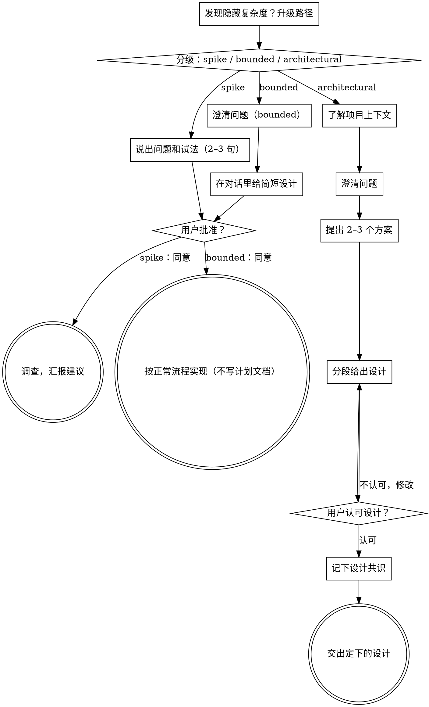

# 把想法聊成设计

通过自然的协作对话，把想法变成完整的设计和规格。

先判断这个需求要走多重的流程，再沿着这条路走：了解上下文、把想法聊清楚、给出设计、取得用户批准。

<HARD-GATE>
在告诉用户你打算怎么做、并得到他批准之前，不调用任何实现类技能，不写代码，不搭项目骨架，不做任何实现动作。下面每条路径上的每个任务都适用：仪式随任务大小伸缩，批准这道关卡不伸缩。
</HARD-GATE>

## 三条路径

问第一个问题之前，先给需求分级并把分级说出来（例如「这个看着是 bounded，我在对话里给一份简短设计，不写规格文件」），让用户可以改：

- **Spike（探路）**：可行性问题（「能不能……」「有没有可能……」「糙一点没关系」），产出是一个答案，不是要留下的代码。用 2–3 句话说清问题和打算怎么试，用户点头后，在保证结论正确的前提下用最省事的办法查清。不写设计文档、不写规格。结论写成建议；做出来的东西都标明是一次性的。
- **Bounded（有边界）**：对仓库里已有代码的明确小改动：加个开关、加个小接口、改一个文件的问题。「懂这类应用」不算 bounded：bounded 指要改的流程已经在仓库里、能读到。没有现成流程可改的，就不是 bounded。问几个关键问题，在**对话里**给一份简短设计（几句话到几小段），然后**停下**。用户对这份设计说「可以」之后才开始实现：bounded 任务的批准和 architectural 一样是硬关卡。不写规格文件，不写实现计划文档。
- **Architectural（架构级）**：新项目、新子系统、改变组件之间的组织方式、改别人依赖的接口。走完整流程：提问、比较方案、分段对齐设计，再把定下的设计交出去。

两条路径拿不准时选重的那条。只能往上升，不能往下降：做到一半发现隐藏的复杂度就升级路径（停下、说明、升级），任务进行中不降级。

## 反模式：「太简单了，不用批准」

每条路径都以用户批准你的打算结束，然后才实现。一个待办清单、一个单函数工具、一处配置改动，设计可能只有对话里两句话，但必须给出来并取得批准。没被检查过的假设，最常在「简单」任务里造成白干。随简单程度缩小的是产出物，批准永远不省。

## 危险信号

| 心里的想法                                  | 实际上                                                           |
| ------------------------------------------- | ---------------------------------------------------------------- |
| 「这太简单了，不用设计」                    | 简单意味着设计短，不是没有设计。对话里两句话，然后等批准。       |
| 「我把它算成 bounded，就不用写规格」        | 想靠贴标签省事，本身就说明拿不准：选重的那条。                   |
| 「bounded，设计很明显，他看的时候我先开工」 | 关卡是批准，不是设计的长短。给出设计，然后停下等「可以」。       |
| 「我懂这类应用，所以是 bounded」            | bounded 看的是仓库，不是你熟不熟。新项目没有现成流程，是架构级。 |
| 「spike 跑通了，代码留着用」                | spike 的产出是答案。要留代码是新需求，重新分级。                 |
| 「变复杂了，但快做完了，不用重新分级」      | 隐藏的复杂度会在中途升级路径。停下来说明。                       |
| 「spike 批准了，后续改动也算批准了」        | 每个任务单独分级、单独批准。                                     |

## 清单

先分级、说出路径，再把这条路径上的每一项列进计划（有 `set_plan` 就用它），按顺序做完。

**Spike：**

1. **了解项目上下文**：够你把探路问题说清楚就行
2. **说出问题和试法**：2–3 句话
3. **取得同意**：点头就够
4. **调查**：在保证正确的前提下尽量省事
5. **汇报结论**：写成建议；做出来的东西标明是一次性的

**Bounded：**

1. **了解项目上下文**：看文件、文档、最近的提交
2. **澄清问题**：一次问一个，只问要紧的
3. **在对话里给简短设计**：做法、要改的文件、怎么测
4. **取得批准**：停下，等明确的「可以」；给出设计的同时开工就是跳过关卡
5. **实现**：按正常的开发流程做（适用 TDD），不写计划文档

**Architectural：**

1. **了解项目上下文**：看文件、文档、最近的提交
2. **澄清问题**：一次问一个，弄清目的、约束和成功标准
3. **提出 2–3 个方案**：写清取舍和你的推荐
4. **给出设计**：按复杂度分段，每段讲完请用户确认
5. **记下设计共识**：把确认过的目标、非目标、约束、候选方案、决定和验收标准写进节点输出，或调用方指定的设计文档
6. **自查规格**：快速检查占位符、矛盾、歧义和范围（见下文）
7. **请用户审阅成文的设计**：继续之前请用户看一遍
8. **交出去**：到此为止；接下来压测、写规格还是实现，由调用这个技能的工作流决定

调用方要求只确认一次时（例如工作流在自己的步骤里确认设计），一次性给出设计（目标、非目标、技术路线、验收标准初稿），不分段确认，也不再单独请用户审阅成文设计，免得同一份设计让用户批两遍。

## 流程图

**终点由工作流决定。** 设计批准后，写进节点输出或指定的文档就停下，下一步由调用的工作流决定。不要从这个技能直接开始实现架构级设计。bounded 的工作照样要做项目要求的验证和收尾。

## 过程

下面几节服务于 bounded 和 architectural 两条路径（spike 到「说出试法、取得同意」就够了）。从「比较方案」往后是架构级才需要的深度；bounded 的全部流程就是：上下文 + 几个问题 + 对话里的简短设计。

**弄懂想法：**

- 先看项目现状（文件、文档、最近的提交）。
- 问细节之前先评估范围：需求里包含多个独立子系统时（例如「做一个带聊天、文件存储、计费和统计的平台」），马上指出来，别在一个需要先拆分的项目上抠细节。
- 项目大到一份规格装不下时，帮用户拆成子项目：有哪些独立部分、彼此什么关系、按什么顺序做。然后对第一个子项目走正常的设计流程，每个子项目各走一遍「规格 → 计划 → 实现」。
- 范围合适的项目，一次问一个问题把想法聊清楚，只关心目的、约束和成功标准。
- 问题用提问工具弹窗问（Claude Code 用自带的 `AskUserQuestion`，其他 CLI 用面板的 `ask_user`），不写成普通文字：一次一个问题，给 2–4 个选项、每个写清后果，推荐的放第一位并在 label 末尾标「（推荐）」。实在列不出选项的开放问题也可以，用户能自己填答案。
- 一个话题要深挖就拆成几个问题，一个一个问。能自己查到的事实自己查，不拿去问。

**比较方案：**

- 提出 2–3 个不同方案，写清取舍。
- 先说你推荐的那个，讲清理由。
- 坚持 YAGNI：每个方案和设计都删掉用不上的功能。

**给出设计：**

- 觉得弄懂要做什么之后，给出设计。
- 每段的长度跟着复杂度走：简单的几句话，细致的 200–300 字。
- 每段讲完问一句目前是否对。
- 覆盖：架构、组件、数据流、错误处理、测试。
- 有讲不通的地方，随时回头澄清。

**为隔离和清晰而设计：**

- 把系统拆成小单元：每个只有一个明确职责，通过定义清楚的接口通信，能单独理解和测试。
- 每个单元都要答得出：它做什么、怎么用、依赖什么。
- 不看内部能不能看懂它做什么？改内部会不会弄坏调用方？答不上来，就是边界还要再划。
- 边界清楚的小单元也更方便你自己干活：能整个装进上下文的代码你推理得更准，文件聚焦时改动也更可靠。文件越长越大，往往说明它做的事太多了。

**在已有代码库里：**

- 提方案前先看清现有结构，跟随已有写法。
- 现有代码的问题影响到这次工作时（例如文件太大、边界不清、职责缠在一起），在设计里带上有针对性的改进，就像好的开发者顺手改善手里的代码。
- 不提无关的重构，专注当前目标。

## 设计之后（架构级）

**文档：**

- 把确认过的设计共识写进节点输出，或调用方指定的设计文档（例如 OpenSpec change 的 `design.md`）。两者都没有时留在对话里，并说明它该放在哪。
- 版本控制提交和收尾属于项目的工作流，不归这个技能。

**自查规格：**
写完规格文档后，换个眼光再看一遍：

1. **占位符：** 有没有「待定」「TODO」、没写完的段落、含糊的需求？改掉。
2. **内部一致：** 各段之间有没有矛盾？架构和功能描述对得上吗？
3. **范围：** 够聚焦、一份实现计划装得下吗？还是要再拆？
4. **歧义：** 有没有需求能理解成两种意思？有就选一种并写明。

发现问题直接改，不用再审一遍，改完继续。

**用户审阅关卡：**
自查通过后，请用户审阅设计共识再往下走。

等用户回复。要改就改设计共识并重新自查。用户批准后才继续。

**实现：**

- 架构级路径上不属于这个技能。把批准的设计交出去，由工作流决定接下来是压测、写规格还是实现。
- 工作流要求写规格文件时，以工作流为准，不按本技能 bounded 路径「不写规格文件」的说法。
